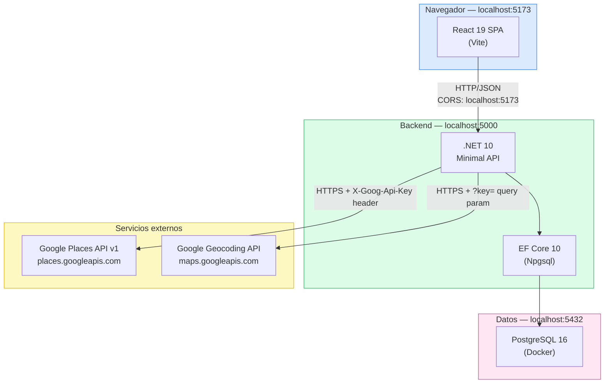
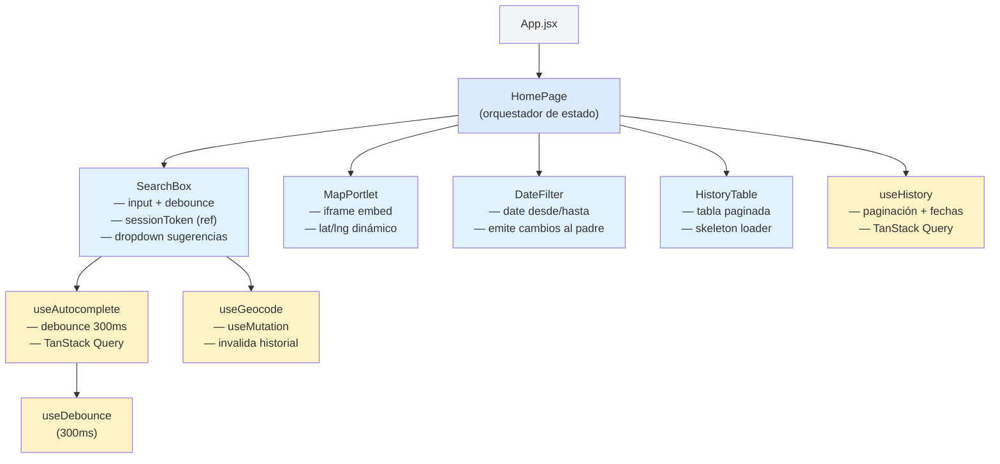
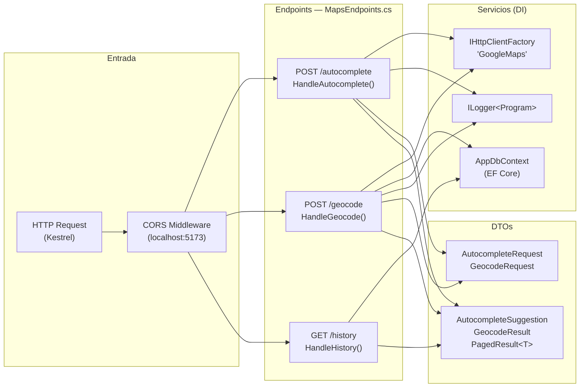
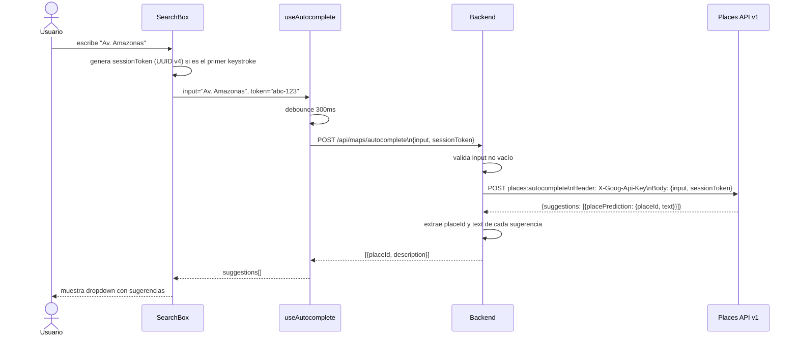
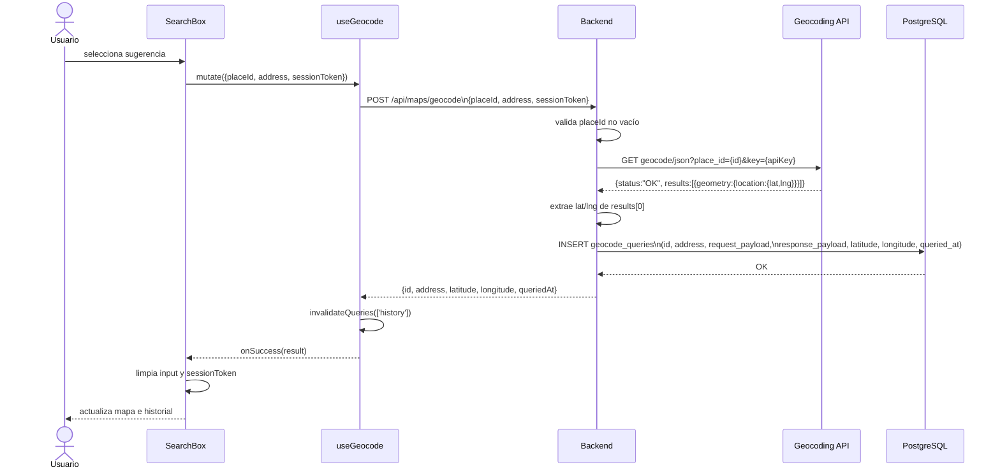
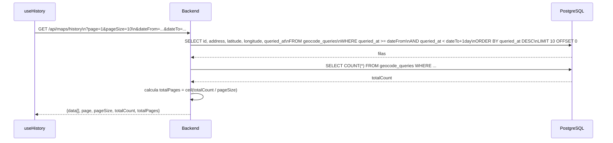

# Arquitectura del Proyecto — Maps Demo

**Versión:** 1.1
**Fecha:** 2026-05-22
**Branch:** feature/maps-autocomplete-geocode-history

---

## Índice

1. [Visión general](#1-visión-general)
2. [Diagrama de componentes](#2-diagrama-de-componentes)
3. [Flujo de datos](#3-flujo-de-datos)
4. [Arquitectura del backend](#4-arquitectura-del-backend)
5. [Arquitectura del frontend](#5-arquitectura-del-frontend)
6. [Esquema de base de datos](#6-esquema-de-base-de-datos)
7. [Dependencias externas](#7-dependencias-externas)
8. [Variables de entorno](#8-variables-de-entorno)
9. [Decisiones técnicas](#9-decisiones-técnicas)
10. [Restricciones y limitaciones conocidas](#10-restricciones-y-limitaciones-conocidas)
11. [Documentación relacionada](#11-documentación-relacionada)

---

## 1. Visión general

Maps Demo es una aplicación web de página única que permite buscar direcciones con autocompletado, obtener sus coordenadas geográficas y persistir el historial de consultas. Está compuesta por tres capas desacopladas: un frontend React, un backend .NET 10 que actúa como proxy seguro hacia Google Maps, y una base de datos PostgreSQL.

El principio de diseño central es que **el frontend nunca llama directamente a Google Maps**. Toda interacción con las APIs de Google pasa por el backend, garantizando que la API key nunca quede expuesta en el cliente.

```
Usuario ──► Frontend (React) ──► Backend (.NET 10) ──► Google Maps APIs
                                        │
                                        └──► PostgreSQL
```

---

## 2. Diagrama de componentes

### 2.1 Vista de sistema



### 2.2 Componentes del frontend



### 2.3 Capas del backend



---

## 3. Flujo de datos

### 3.1 Autocomplete (búsqueda de dirección)



**Notas:**
- El sessionToken viaja del frontend → backend → Google para agrupar la sesión de facturación.
- No se persiste ningún dato en esta etapa.
- Si el input tiene menos de 3 caracteres, `useAutocomplete` deshabilita la query (`enabled: false`).

---

### 3.2 Geocodificación (selección de sugerencia)



**Notas:**
- El sessionToken cierra la sesión de facturación de Places API.
- `response_payload` almacena el JSON completo de Google (para auditoría).
- La invalidación de `['history']` fuerza un refetch del historial automáticamente.

---

### 3.3 Historial (consulta paginada)



**Notas:**
- `dateTo` usa comparación `< dateTo + 1 día` (exclusivo) para incluir registros de todo el día seleccionado.
- Dos queries a la DB: una para los datos paginados y otra para el conteo total.

---

## 4. Arquitectura del backend

### 4.1 Estructura de archivos

```
backend/MapsDemo.Api/
├── Program.cs                    — punto de entrada, composición DI
├── MapsDemo.Api.csproj           — dependencias NuGet
├── appsettings.json              — configuración base
├── appsettings.Development.json  — overrides de desarrollo
├── Properties/
│   └── launchSettings.json       — perfil http: puerto 5000
├── Data/
│   ├── GeocodeQuery.cs           — entidad EF Core
│   ├── AppDbContext.cs           — DbContext + Fluent API
│   └── AppDbContextFactory.cs    — factory para migraciones design-time
├── DTOs/
│   ├── AutocompleteRequest.cs    — { Input, SessionToken }
│   ├── GeocodeRequest.cs         — { PlaceId, Address, SessionToken }
│   ├── AutocompleteSuggestion.cs — { PlaceId, Description }
│   ├── GeocodeResult.cs          — { Id, Address, Latitude, Longitude, QueriedAt }
│   └── PagedResult.cs            — { Data, Page, PageSize, TotalCount, TotalPages }
├── Endpoints/
│   └── MapsEndpoints.cs          — 3 handlers Minimal API
└── Migrations/
    ├── 20260507115624_InitialCreate.cs
    ├── 20260507115624_InitialCreate.Designer.cs
    └── AppDbContextModelSnapshot.cs
```

### 4.2 Composición del DI container (Program.cs)

| Servicio | Lifetime | Propósito |
|----------|----------|-----------|
| `AppDbContext` | Scoped | Acceso a PostgreSQL via EF Core |
| `IHttpClientFactory ("GoogleMaps")` | Singleton | Pool de conexiones HTTP hacia Google |
| `ILogger<Program>` | Singleton | Logging estructurado |
| CORS Policy (default) | Singleton | Permite `http://localhost:5173` |

### 4.3 Manejo de errores por endpoint

| Condición | HTTP | Tipo de response |
|-----------|------|-----------------|
| Input vacío / PlaceId vacío | 400 | `{ title: string }` |
| API key no configurada | 500 | ProblemDetails |
| Google Maps retorna error HTTP | 502 | ProblemDetails |
| Google Geocoding retorna status ≠ OK | 502 | ProblemDetails |
| Excepción no esperada | 500 | ProblemDetails |

---

## 5. Arquitectura del frontend

### 5.1 Estructura de archivos

```
frontend/maps-demo-ui/src/
├── main.jsx              — bootstrap: StrictMode + QueryClientProvider
├── App.jsx               — envoltura mínima → HomePage
├── index.css             — @import "tailwindcss" + reset global
├── hooks/
│   ├── useDebounce.js    — setTimeout genérico
│   ├── useAutocomplete.js — useQuery + debounce
│   ├── useGeocode.js     — useMutation + invalidación
│   └── useHistory.js     — useQuery con params de paginación
├── components/
│   ├── SearchBox.jsx     — input controlado, sessionToken, dropdown
│   ├── MapPortlet.jsx    — iframe embed de Google Maps
│   ├── DateFilter.jsx    — dos inputs date + botón limpiar
│   └── HistoryTable.jsx  — tabla + skeleton + paginación
└── pages/
    └── HomePage.jsx      — orquestador de estado compartido
```

### 5.2 Gestión de estado

| Estado | Ubicación | Mecanismo |
|--------|-----------|-----------|
| Texto del input de búsqueda | `SearchBox` | `useState` local |
| sessionToken activo | `SearchBox` | `useRef` (no reactivo) |
| Sugerencias de autocomplete | `useAutocomplete` | TanStack Query cache |
| Resultado actual de geocode | `HomePage` | `useState` — elevado |
| Página actual del historial | `HomePage` | `useState` — elevado |
| Filtros de fecha | `HomePage` | `useState` — elevado |
| Datos del historial | `useHistory` | TanStack Query cache |

**Por qué `useRef` para sessionToken:** El token no debe disparar re-renders. Es un valor mutable que solo importa en el momento del envío del request, no para el renderizado del componente.

### 5.3 Estrategia de caché (TanStack Query)

| Query key | Cuándo refetch |
|-----------|----------------|
| `['autocomplete', input, token]` | Input cambia (con debounce) |
| `['history', page, pageSize, dateFrom, dateTo]` | Parámetros cambian o `invalidateQueries` |

La cache de `history` se invalida automáticamente tras cada geocodificación exitosa (`useGeocode.onSuccess`), lo que actualiza el historial sin acción explícita del usuario.

---

## 6. Esquema de base de datos

### 6.1 Tabla: `geocode_queries`

```sql
CREATE TABLE geocode_queries (
    id               UUID            PRIMARY KEY DEFAULT gen_random_uuid(),
    address          VARCHAR(500)    NOT NULL,
    request_payload  JSONB           NOT NULL,
    response_payload JSONB           NOT NULL,
    latitude         NUMERIC(10,8)   NOT NULL,
    longitude        NUMERIC(11,8)   NOT NULL,
    queried_at       TIMESTAMPTZ     NOT NULL DEFAULT now()
);
```

### 6.2 Descripción de columnas

| Columna | Tipo | Descripción |
|---------|------|-------------|
| `id` | UUID | PK generada por PostgreSQL con `gen_random_uuid()` |
| `address` | VARCHAR(500) | Dirección legible enviada desde el frontend |
| `request_payload` | JSONB | Request enviado a Google: `{placeId, address}` |
| `response_payload` | JSONB | Response completo de Geocoding API (para auditoría) |
| `latitude` | NUMERIC(10,8) | Latitud con 8 decimales (~1mm de precisión) |
| `longitude` | NUMERIC(11,8) | Longitud con 8 decimales |
| `queried_at` | TIMESTAMPTZ | Timestamp UTC de la consulta |

### 6.3 Por qué JSONB para los payloads

- Permite consultas y filtros sobre campos internos del JSON con operadores `->` y `->>`
- Validación de formato JSON al insertar (PostgreSQL rechaza JSON inválido)
- Compresión y desduplicación interna de claves por parte de PostgreSQL
- Facilita auditoría sin necesidad de parsear strings

### 6.4 Precisión de coordenadas

- `NUMERIC(10,8)` para latitud: 10 dígitos en total, 8 decimales → ±0.00000001° ≈ 1mm en el ecuador
- `NUMERIC(11,8)` para longitud: 11 dígitos en total, 8 decimales → permite almacenar valores hasta ±180°

### 6.5 Migración

| Migración | Fecha | Descripción |
|-----------|-------|-------------|
| `InitialCreate` | 2026-05-07 | Crea tabla `geocode_queries` |

Aplicada con: `dotnet ef database update` desde `backend/MapsDemo.Api/`.

---

## 7. Dependencias externas

### 7.1 Google Places API v1

| Atributo | Valor |
|----------|-------|
| Endpoint | `https://places.googleapis.com/v1/places:autocomplete` |
| Método | POST |
| Autenticación | Header `X-Goog-Api-Key` |
| Propósito | Sugerencias de autocompletado de direcciones |
| Facturación | Por sesión (agrupada con sessionToken) |
| Documentación | [New Places API](https://developers.google.com/maps/documentation/places/web-service/op-overview) |

**Request enviado:**
```json
{
  "input": "Av. Amazonas",
  "sessionToken": "uuid-v4"
}
```

**Response parseado:**
```json
{
  "suggestions": [
    {
      "placePrediction": {
        "placeId": "ChIJ...",
        "text": { "text": "Av. Amazonas, Quito, Ecuador" }
      }
    }
  ]
}
```

### 7.2 Google Geocoding API

| Atributo | Valor |
|----------|-------|
| Endpoint | `https://maps.googleapis.com/maps/api/geocode/json` |
| Método | GET |
| Autenticación | Query param `?key=` ⚠️ (ver decisión técnica DT-05) |
| Propósito | Obtener lat/lng a partir de un `place_id` |
| Facturación | Por request (el sessionToken cierra la sesión Places) |
| Documentación | [Geocoding API](https://developers.google.com/maps/documentation/geocoding/requests-geocoding) |

**URL construida:**
```
GET https://maps.googleapis.com/maps/api/geocode/json
    ?place_id={placeId}
    &key={GOOGLE_MAPS_API_KEY}
```

**Response parseado:**
```json
{
  "status": "OK",
  "results": [
    {
      "geometry": {
        "location": { "lat": -0.177432, "lng": -78.485938 }
      }
    }
  ]
}
```

### 7.3 Dependencias NuGet (backend)

| Paquete | Versión | Propósito |
|---------|---------|-----------|
| `Microsoft.AspNetCore.OpenApi` | 10.0.7 | Generación de OpenAPI / Swagger |
| `Npgsql.EntityFrameworkCore.PostgreSQL` | 10.0.1 | Proveedor EF Core para PostgreSQL |
| `Microsoft.EntityFrameworkCore.Design` | 10.0.7 | Herramientas CLI para migraciones |
| `dotenv.net` | 4.0.2 | Carga de variables desde `.env` |

### 7.4 Dependencias npm (frontend)

| Paquete | Versión | Propósito |
|---------|---------|-----------|
| `react` | ^19.2.5 | Framework UI |
| `react-dom` | ^19.2.5 | Renderizado DOM |
| `@tanstack/react-query` | ^5.100.9 | Cache de server state, loading, error |
| `axios` | ^1.16.0 | Cliente HTTP con interceptors |
| `dayjs` | ^1.11.20 | Formateo de fechas en la tabla de historial |
| `uuid` | — | Generación de sessionToken UUID v4 |
| `tailwindcss` | ^4.2.4 | Estilos utilitarios |
| `vite` | ^8.0.10 | Bundler y dev server |
| `@vitejs/plugin-react` | ^6.0.1 | Plugin React para Vite |
| `@tailwindcss/vite` | ^4.2.4 | Integración Tailwind con Vite |

### 7.5 Infraestructura

| Componente | Tecnología | Configuración |
|------------|-----------|---------------|
| Base de datos | PostgreSQL 16 | Docker Compose, volumen `postgres_data` |
| Contenedor | Docker | `docker-compose.yml` en raíz del proyecto |
| Healthcheck | `pg_isready` | Interval 10s, timeout 5s, retries 5 |

---

## 8. Variables de entorno

Todas las variables sensibles viven en `.env` en la raíz del proyecto. El archivo está en `.gitignore`.

### Backend (`.env`)

| Variable | Obligatoria | Descripción |
|----------|-------------|-------------|
| `GOOGLE_MAPS_API_KEY` | Sí | API key con Places API v1 y Geocoding API habilitadas |
| `POSTGRES_USER` | Sí | Usuario de PostgreSQL |
| `POSTGRES_PASSWORD` | Sí | Contraseña de PostgreSQL |
| `POSTGRES_DB` | Sí | Nombre de la base de datos |
| `POSTGRES_CONNECTION_STRING` | No | Connection string completa (alternativa a las vars individuales) |

**Cómo se carga el `.env`:** `Program.cs` busca el archivo en 4 rutas candidatas relativas al directorio de trabajo y al `AppContext.BaseDirectory`, y lo parsea manualmente (sin dependencia de dotenv.net en runtime).

### Frontend (`.env` en `frontend/maps-demo-ui/`)

| Variable | Obligatoria | Descripción |
|----------|-------------|-------------|
| `VITE_API_BASE_URL` | No | URL base del backend (default: `http://localhost:5000`) |

**Nota:** Las variables `VITE_*` quedan embebidas en el bundle de producción. Por eso la API key de Google Maps nunca se define aquí.

---

## 9. Decisiones técnicas

### DT-01 — .NET Minimal API en lugar de Controllers

**Decisión:** Usar Minimal API (`app.MapPost(...)`) en lugar del patrón MVC con Controllers.

**Razones:**
- El proyecto es pequeño (3 endpoints) y no requiere la estructura de un Controller
- Menos boilerplate: no se necesita `[ApiController]`, `[Route]`, ni atributos de binding
- Los handlers son funciones puras en una clase estática, fáciles de testear de forma unitaria
- Rendimiento marginalmente mejor al eliminar el pipeline de MVC

**Tradeoff:** Si el proyecto crece significativamente, migrar a Controllers permite mejor organización y features como filtros de acción.

---

### DT-02 — Patrón Proxy para Google Maps (seguridad de API key)

**Decisión:** El frontend nunca llama directamente a Google Maps. Todas las llamadas pasan por el backend.

**Razones:**
- La API key de Google Maps no aparece en el bundle del frontend ni en las DevTools del navegador
- El backend puede agregar lógica de rate limiting, caché o transformación de responses sin cambiar el frontend
- Se cumple el principio de que las APIs de Google son "server-side only"

**Tradeoff:** Agrega latencia (un hop adicional). Para una app de producción con alto volumen, el backend necesitaría ser escalable horizontalmente o agregar caché de responses de autocomplete.

---

### DT-03 — sessionToken UUID v4 para facturación de Places API

**Decisión:** El frontend genera un UUID v4 al inicio de cada sesión de búsqueda y lo envía en cada request de autocomplete y en el geocode final.

**Razones:**
- Google Places API agrupa todos los requests de una sesión bajo un único costo de "Place Details" si se cierra con una llamada al Geocoding API
- Sin sessionToken, cada llamada de autocomplete se factura individualmente
- El token se limpia después de cada geocodificación para que la siguiente búsqueda inicie una nueva sesión de facturación

**Implementación:** `useRef` en lugar de `useState` para no disparar re-renders al generar el token.

---

### DT-04 — TanStack Query para server state en el frontend

**Decisión:** Usar TanStack Query (`@tanstack/react-query`) para todas las llamadas HTTP en lugar de `useEffect` + `useState`.

**Razones:**
- Manejo declarativo de estados de carga, error y datos sin boilerplate manual
- Cache automático: si el usuario navega y vuelve, los datos del historial no se re-fetean innecesariamente
- `invalidateQueries` permite coordinar la actualización del historial tras un geocode sin prop drilling ni contextos
- `staleTime` configurable por query para controlar cuándo los datos se consideran obsoletos

---

### DT-05 — API key en query string para Geocoding API ⚠️

**Decisión:** La Geocoding API recibe la clave como `?key=` en la URL (en lugar de un header).

**Razones:**
- La Geocoding API REST no soporta `X-Goog-Api-Key` como header (a diferencia de Places API v1)
- La sintaxis `?key=` es la documentada y recomendada por Google para esta API

**Riesgo identificado:** La URL completa (con la key) puede aparecer en logs de middleware, proxies y herramientas de observabilidad. Documentado como issue crítico en `docs/reviews/code-quality-review.md`.

**Mitigación sugerida:** Usar un servidor de metadatos o un secret manager que construya la URL en runtime sin exponerla en logs, o sanitizar los logs de URLs que contengan `?key=`.

---

### DT-06 — JSONB para almacenar payloads de Google Maps

**Decisión:** `request_payload` y `response_payload` se almacenan como `JSONB` en PostgreSQL, no como `TEXT`.

**Razones:**
- PostgreSQL valida el formato JSON al insertar, previniendo datos corruptos
- Permite consultas directas sobre campos internos (`response_payload->'results'->0->'formatted_address'`) sin parsear en la aplicación
- El tipo JSONB comprime y deduplicates claves, siendo más eficiente en espacio que TEXT

---

### DT-07 — Carga manual del `.env` en Program.cs

**Decisión:** En lugar de usar la API de `dotenv.net` con `probeForEnv`, el `.env` se carga con un parser manual que busca en 4 rutas candidatas.

**Razones:**
- La opción `probeForEnv` de dotenv.net no encontraba el archivo consistentemente en todos los entornos (development, design-time de EF Core, CI)
- El parser manual es transparente, sin magia: lee línea por línea y hace `Environment.SetEnvironmentVariable`
- La búsqueda en múltiples rutas candidatas funciona tanto con `dotnet run` (CWD = proyecto) como con el binario compilado (AppContext.BaseDirectory = bin/Debug/net10.0/)

---

### DT-08 — Debounce de 300ms para autocomplete

**Decisión:** Las llamadas a `/api/maps/autocomplete` se retardan 300ms después del último keystroke.

**Razones:**
- Evita enviar una request por cada tecla presionada, reduciendo costos de Places API
- 300ms es el umbral estándar de UX que no se percibe como lentitud
- Se implementa con `useEffect` + `setTimeout` en `useDebounce.js` para evitar dependencias adicionales (no se usa `lodash.debounce`)

---

## 10. Restricciones y limitaciones conocidas

| # | Descripción | Severidad | Issue relacionado |
|---|-------------|-----------|-------------------|
| 1 | API key de Geocoding expuesta en query string de URL (visible en logs) | 🔴 Alta | `code-quality-review.md` #1 |
| 2 | Sin validación de longitud mínima (3 chars) en autocomplete | 🔴 Alta | `code-quality-review.md` #2 |
| 3 | Acceso a `results[0]` sin verificar que el array no esté vacío | 🔴 Alta | `code-quality-review.md` #5 |
| 4 | Sin índice en columna `queried_at` (impacto en performance con alto volumen) | 🟡 Media | `code-quality-review.md` #10 |
| 5 | CORS hardcodeado a `localhost:5173` (no configurable sin recompilar) | 🟡 Media | `code-quality-review.md` #12 |
| 6 | Dropdown de sugerencias no navegable con teclado | 🔴 Alta | `accessibility-review.md` SearchBox |
| 7 | Labels del DateFilter no asociados con `htmlFor`/`id` | 🔴 Alta | `accessibility-review.md` DateFilter |
| 8 | `lang="en"` en `index.html` con contenido en español | 🔴 Alta | `accessibility-review.md` index.html |
| 9 | `MapPortlet` usa iframe embed sin API key (legacy URL) — puede dejar de funcionar | 🟡 Media | — |
| 10 | Sin CancellationToken en los handlers — requests cancelados siguen ejecutándose | 🟡 Media | `code-quality-review.md` #8 |
| 11 | `pageSize` sin límite superior — permite cargar la tabla completa en una sola request | 🟡 Media | `code-quality-review.md` #7 |
| 12 | `page=0` o negativo genera error de BD en `.Skip(-pageSize)` | 🟡 Media | `code-quality-review.md` #6 |

---

## 11. Documentación relacionada

| Documento | Ruta | Descripción |
|-----------|------|-------------|
| Spec del feature | `docs/specs/MAPS_AUTOCOMPLETE_GEOCODE_HISTORY.md` | Requerimientos, DTOs, plan de implementación y criterios de aceptación |
| Casos de prueba QA | `docs/qa/test-cases.md` | 56 casos de prueba para los tres endpoints y el frontend |
| Revisión de accesibilidad | `docs/reviews/accessibility-review.md` | 18 issues WCAG en componentes React |
| Revisión de calidad de código | `docs/reviews/code-quality-review.md` | 17 issues en el backend .NET |
